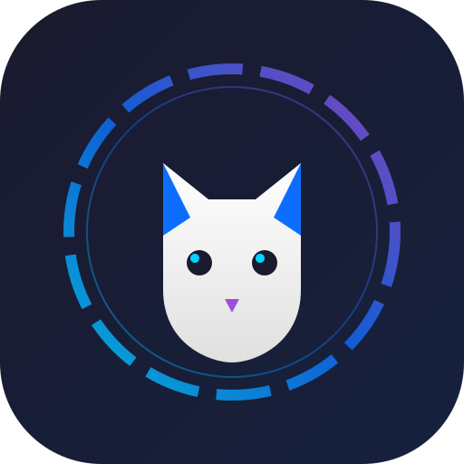
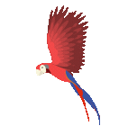
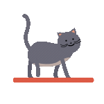
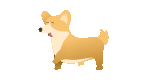
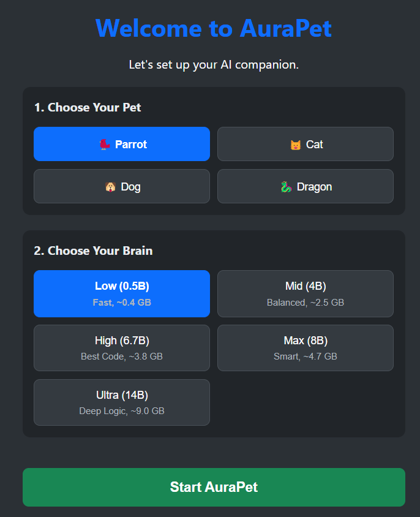
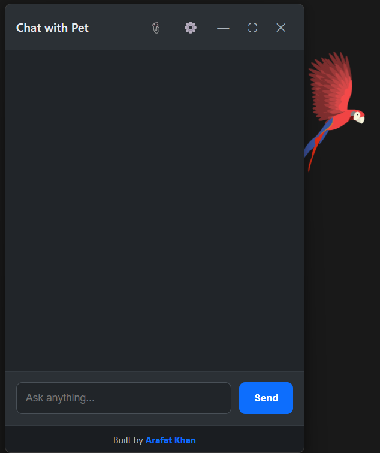
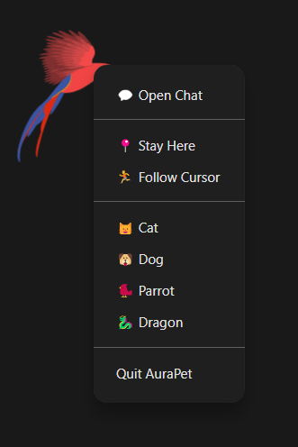

  <!-- Replaced SVG with your logo.png -->
  

  <h1>AuraPet</h1>
  
Your AI-powered desktop companion. A tiny animated pet that lives on your screen, chats with you, and runs entirely on your local machine.

  <!-- Action Buttons -->
  
  
  
   
  
  <!-- Info Badges -->
  
  
  

---

## 🌟 Meet Your Companion

  
  
  
  

AuraPet is a lightweight Electron desktop application that turns a Lottie animation into an interactive AI pet. It sits on top of all your other windows, follows your cursor around the screen, idles with cute wander animations, and answers questions using a **local Ollama model**.

No accounts. No cloud. No API keys. Everything runs 100% locally on your computer.

---

## 🚀 Installation

1. Visit our website: **[aurapet-app.netlify.app](https://aurapet-app.netlify.app/)** or go to the [Releases page](https://github.com/iamthearafatkhan/aurapet/releases/latest).
2. Download **`AuraPet Setup 1.4.0.exe`**.
3. Run the installer and launch AuraPet.
4. Pick your pet and your AI model on the setup screen, and you're ready to go!

> **You do not need to install Ollama, Python, or anything else.** AuraPet automatically manages the AI engine for you.

---

## 📸 How It Works

  
   
  <em>Zero-Config Setup</em>

 

  
  

---

## 🧠 Choosing an AI Brain

Bigger models are smarter, but require more RAM and storage. You can change this anytime in the app settings.

| Option | Model | Download size | RAM needed | Good for |
|---|---|---|---|---|
| **Low (0.5B)** | `decide-0.5b` | **~0.4 GB** | ~1 GB | Old PCs, casual chat |
| **Mid (4B)** ⭐ | `qwen:latest` | **~2.5 GB** | ~4 GB | **Recommended.** Balanced |
| **High (6.7B)** | `deepseek-coder:6.7b` | **~3.8 GB** | ~6 GB | Writing and coding |
| **Max (8B)** | `llama3:8b` | **~4.7 GB** | ~8 GB | Smart assistant |
| **Ultra (14B)** | `qwen:14b` | **~9.0 GB** | ~16 GB | Deep reasoning |

---

## 🔧 Troubleshooting & FAQ

**How do I reset the app to see the setup screen again?**
Press `Windows Key + R`, type `%appdata%\AuraPet`, and delete the `settings.json` file. Restart the app.

**Where is the app installed vs. where is my data saved?**
- **Program Files:** `AppData\Local\Programs\AuraPet`
- **User Data (Settings & Models):** `AppData\Roaming\AuraPet`

**The chat window is transparent over YouTube videos.**
This is a known Electron/Windows GPU compositing bug. It does not affect functionality. We are looking into a fix.

---

## 🎨 Credits

- **Animations** — [LottieFiles.com](https://lottiefiles.com/) community creators
- **AI engine** — [Ollama](https://ollama.com/)
- **Built with** — Electron & Lottie-Web

## 📄 License

MIT © Arafat Khan — see [LICENSE](LICENSE) for details.

---

  <a href="https://aurapet-app.netlify.app/"><b>Website</b></a> • 
  <a href="https://github.com/iamthearafatkhan/aurapet/issues"><b>Report an Issue</b></a> • 
  <a href="https://github.com/iamthearafatkhan/aurapet/releases/latest"><b>Download</b></a>

